<p align="center"></p>

<h1 align="center">GCPShot</h1>

<p align="center"><strong>Capture. Crie. Compartilhe.</strong><br>
Captura de tela, editor de anotações, estúdio de imagem e Color Lab para Windows, macOS e Linux.</p>

<p align="center">
  <a href="https://github.com/cliqueprojeto/GCPShot/releases/latest"></a>
  
</p>

<p align="center">Desenvolvido por <strong>Bruno Albertini</strong> · <a href="https://gestaoculturalpro.com.br/">Gestão Cultural Pro</a></p>

<p align="center">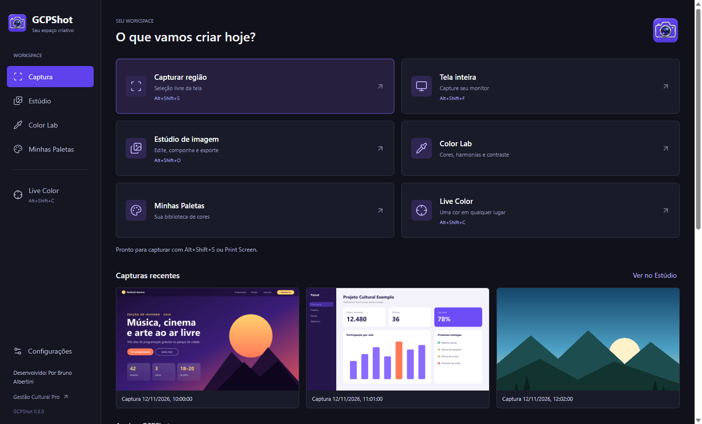</p>

---

## Sumário

- [Download e instalação](#download-e-instalação)
- [Captura e editor de anotações](#captura-e-editor-de-anotações)
- [Estúdio de imagem](#estúdio-de-imagem)
- [Color Lab, Live Color e paletas](#color-lab-live-color-e-paletas)
- [Teclas de atalho inteligentes](#teclas-de-atalho-inteligentes)
- [Atualizações automáticas](#atualizações-automáticas)
- [Bandeja do sistema](#bandeja-do-sistema)
- [Linux: Wayland, KDE Plasma e BigLinux](#linux-wayland-kde-plasma-e-biglinux)
- [Privacidade](#privacidade)
- [Desenvolvimento](#desenvolvimento)

---

## Download e instalação

Baixe o instalador do seu sistema em **[Releases](https://github.com/cliqueprojeto/GCPShot/releases/latest)**:

| Sistema | Arquivo |
| --- | --- |
| Windows 10 e 11 | `GCPShot-<versão>-Windows-x64.exe` |
| macOS 14+ Apple Silicon (M1 ou posterior) | `GCPShot-<versão>-macOS-arm64.dmg` |
| macOS 14+ Intel | `GCPShot-<versão>-macOS-x64.dmg` |
| Debian 12+, Ubuntu 22.04+, Linux Mint 21+ | `GCPShot-<versão>-Linux-amd64.deb` |
| Fedora, openSUSE | `GCPShot-<versão>-Linux-x86_64.rpm` |
| Arch, BigLinux, Manjaro | `gcpshot-<versão>-1-x86_64.pkg.tar.zst` |

Passo a passo para macOS e Linux: [INSTALL-MAC-LINUX.md](INSTALL-MAC-LINUX.md).
Depois da primeira instalação, as novas versões chegam pelo próprio aplicativo.

---

## Captura e editor de anotações

<p align="center">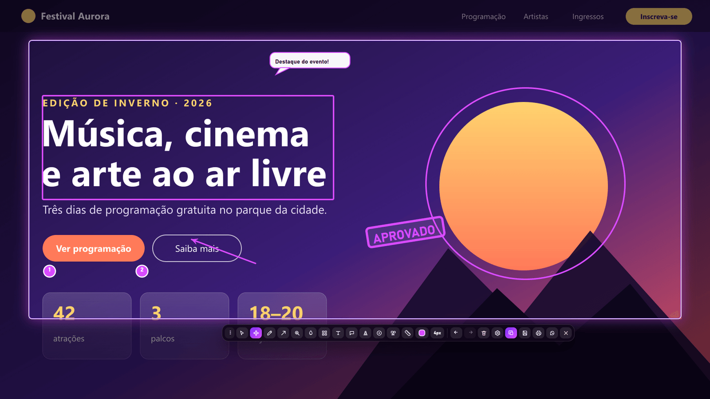</p>

- **Capturar região:** arraste para selecionar qualquer área. Alças nos cantos ajustam a seleção.
- **Capturar tela inteira:** abre o editor já com o monitor inteiro. Com vários monitores, você escolhe qual.
- **Print Screen** opcional para copiar a região direto para a área de transferência.
- Barra de ferramentas flutuante sobre a seleção:

| Ferramenta | Para que serve |
| --- | --- |
| Caneta, linha, seta | Destacar e apontar |
| Retângulo, elipse, estrela | Enquadrar elementos |
| Texto e **balão de fala** | Comentários e legendas, com fundo preenchido, transparente ou contorno |
| **Carimbos** (Aprovado, Revisão, Privado, Atenção ou personalizado) | Validar telas e documentos |
| **Numeração** automática (1, 2, 3…) | Passo a passo e tutoriais |
| **Lupa** retangular ou elíptica | Ampliar um detalhe |
| **Desfoque** e **pixelização** | Esconder dados sensíveis |
| **Régua** calibrada em centímetros | Medir distâncias na tela |
| Cor, espessura, desfazer e refazer | Ajustes finos |

- Ações em um clique: **copiar**, **salvar** (PNG, JPEG ou PDF), **imprimir** ou **preparar para o WhatsApp Web**. `Enter` copia e fecha. Toda captura copiada ou salva vai para a biblioteca do Estúdio.

---

## Estúdio de imagem

A biblioteca guarda as últimas capturas para editar, combinar e exportar.

<p align="center">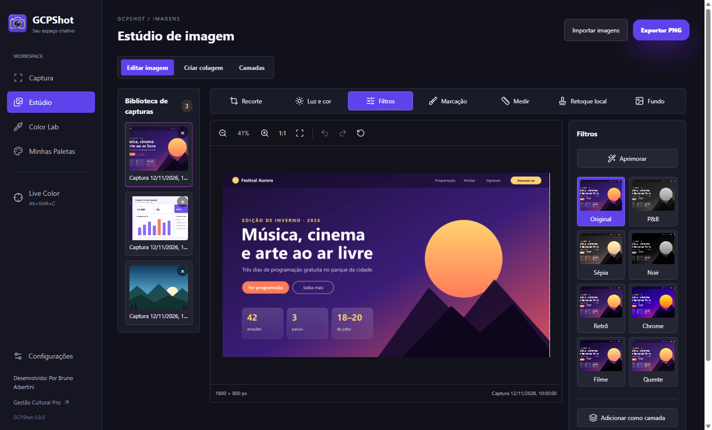</p>

**Editar imagem**

- **Recorte** livre ou em proporções fixas, girar, espelhar e endireitar.
- **Luz e cor:** brilho, exposição, contraste, destaques, sombras, saturação, temperatura, matiz e vinheta.
- **Filtros:** Original, P&B, Sépia, Noir, Retrô, Chrome, Filme, Quente e mais, além do botão **Aprimorar**.
- **Marcação** e **Medir** sobre a imagem.
- **Retoque local** com pincel de clonagem (`Alt + clique` define a origem).
- **Fundo:** remover, desfocar ou substituir a cor de fundo, com tolerância ajustável.
- Salvar uma cópia na biblioteca ou exportar em PNG.

<p align="center">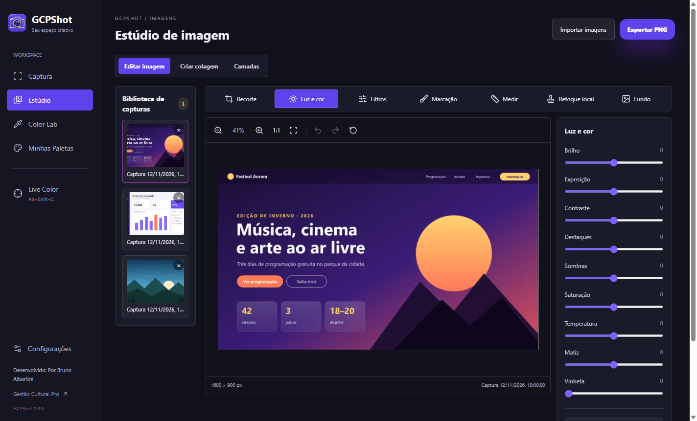</p>

**Criar colagem:** layouts prontos (2 colunas, 2 linhas, 3 colunas, grade 2×2, destaque à esquerda ou no topo), com espaçamento, margem e cor de fundo.

<p align="center">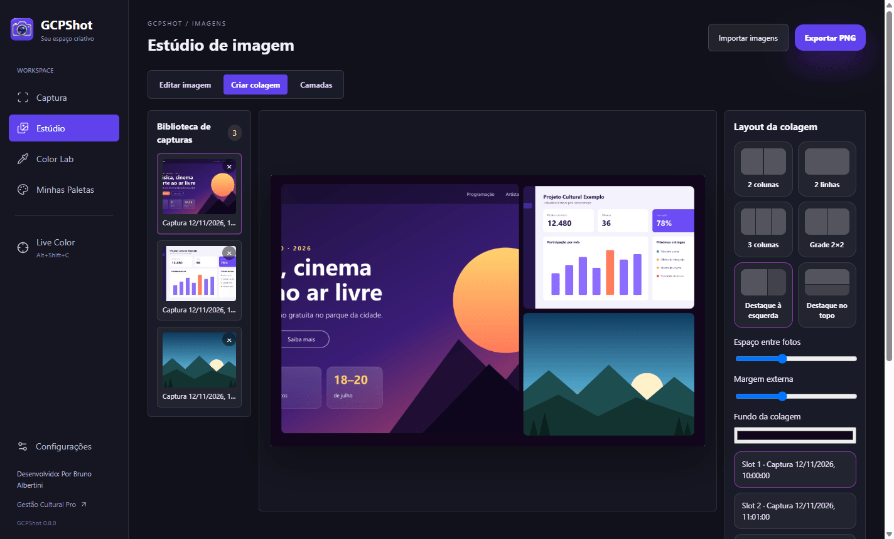</p>

**Camadas:** sobreponha imagens e ajuste posição, tamanho, rotação, opacidade e ordem de cada camada.

<p align="center">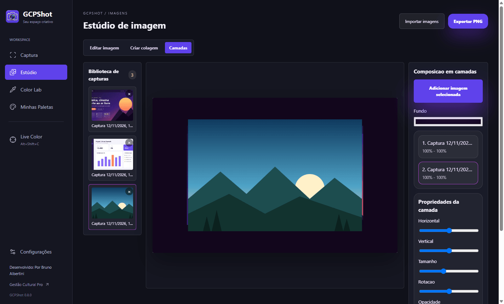</p>

---

## Color Lab, Live Color e paletas

<p align="center">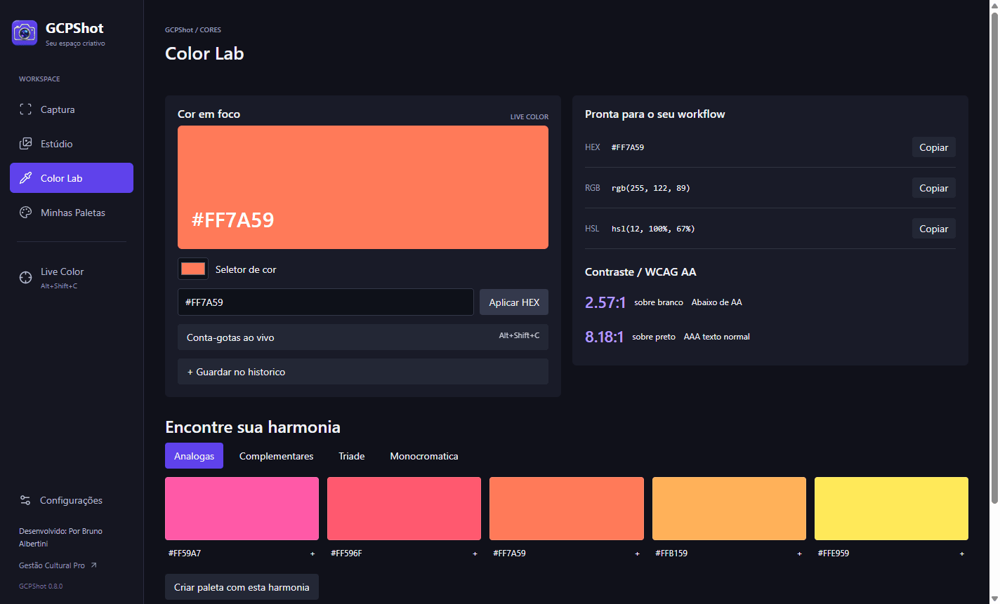</p>

- **Cor em foco** com HEX, RGB e HSL prontos para copiar.
- **Contraste WCAG** sobre branco e preto (AA e AAA).
- **Harmonias:** análogas, complementares, tríade e monocromática, e com um clique viram uma paleta.
- **Histórico** com as últimas cores escolhidas.

**Live Color** é o conta-gotas para qualquer ponto da tela, com **lupa ampliada em tempo real**, grade de pixels e valor atualizado a cada movimento. As setas ajustam 1 pixel (Shift + setas: 10 px), clique ou `Enter` copia e `Esc` cancela.

<p align="center">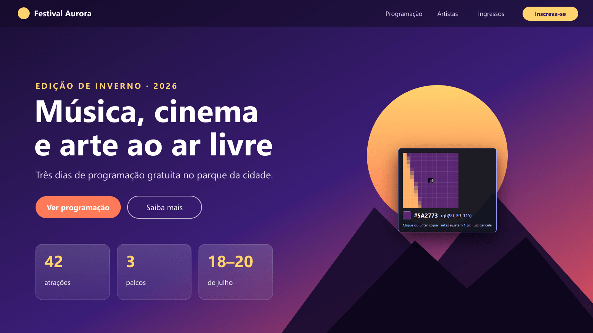</p>

**Minhas Paletas:** crie, renomeie, edite, busque, copie e exporte paletas em **JSON** ou **CSS** (variáveis `--paleta-*`). Também é possível importar paletas.

<p align="center">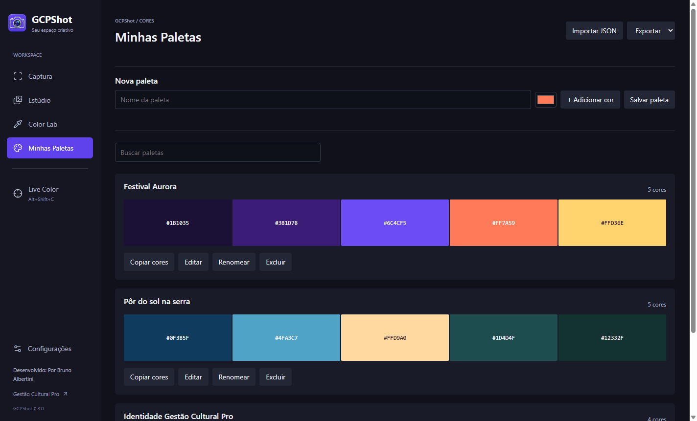</p>

---

## Teclas de atalho inteligentes

O GCPShot **verifica no seu sistema quais combinações estão livres** antes de atribuí-las, e sugere todas as disponíveis, das mais fáceis para as menos fáceis.

<p align="center">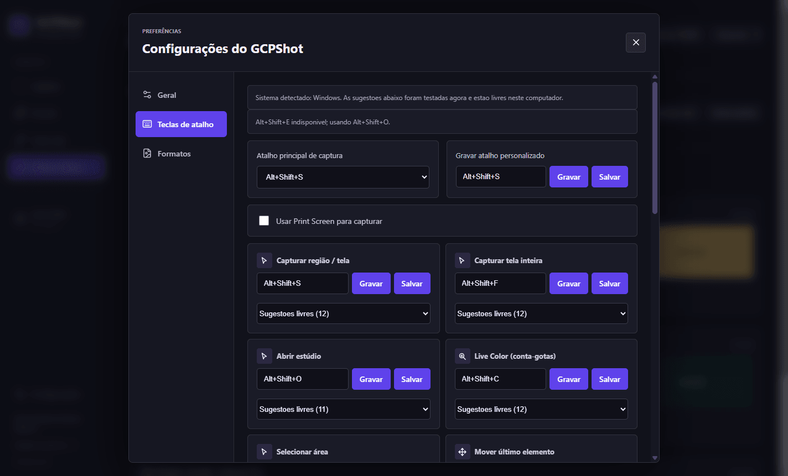</p>

- Cada sistema tem sugestões próprias. Combinações que roubariam teclas de outros programas nunca são sugeridas: `Ctrl+Shift+letra` (Salvar como, Inspecionar), `Ctrl+Alt` no Windows (é o AltGr dos teclados ABNT2), `Cmd+Shift+3/4/5/6` no macOS e `Ctrl+Alt+F1…F12/T/L` no Linux.
- No Linux, os atalhos já usados pelo **KDE Plasma** e pelo **GNOME** são lidos da configuração do sistema e excluídos.
- Se uma tecla estiver ocupada por outro programa, o GCPShot usa a próxima sugestão livre e avisa, como na imagem acima.
- Todos os atalhos do editor (ferramentas, copiar, salvar, desfazer…) também podem ser regravados.

| Ação | Sugestão padrão (Windows/Linux) | macOS |
| --- | --- | --- |
| Capturar região | `Alt+Shift+S` | `Ctrl+Shift+S` |
| Capturar tela inteira | `Alt+Shift+F` | `Ctrl+Shift+F` |
| Abrir o Estúdio | `Alt+Shift+E` | `Ctrl+Shift+E` |
| Live Color | `Alt+Shift+C` | `Ctrl+Shift+C` |

---

## Atualizações automáticas

<p align="center">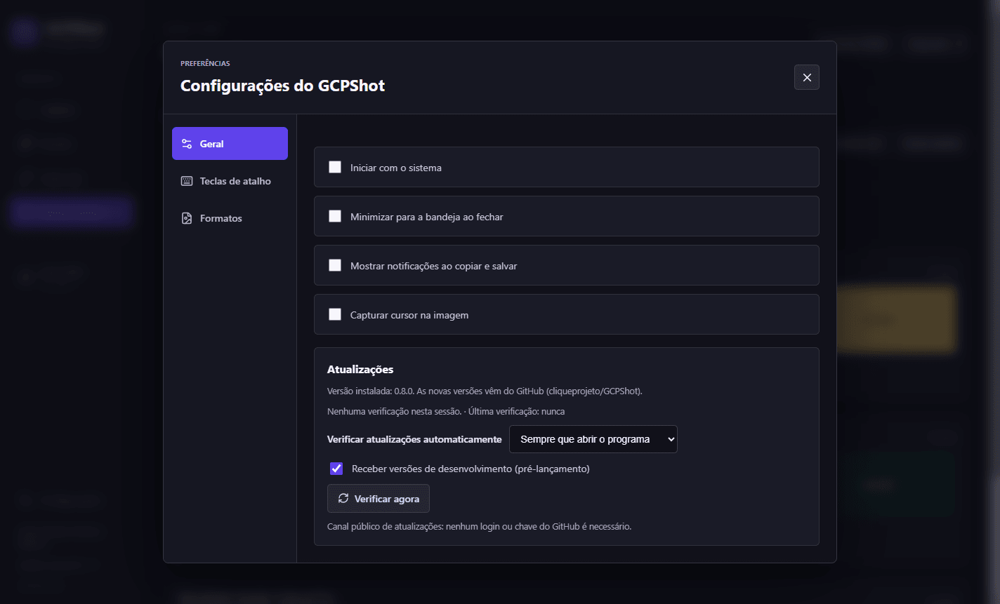</p>

Em **Configurações › Geral › Atualizações**:

- Verificar **sempre que abrir o programa**, **uma vez por dia** ou **somente manualmente**, além do botão **Verificar agora**.
- Opção de receber **versões de desenvolvimento** (pré-lançamento).
- Download com progresso e instalação pelo próprio app: Windows (instalador silencioso), Linux (`.deb`, `.rpm` ou Arch, com a senha do sistema) e macOS (abre o DMG).
- O canal é público, sem login nem chave do GitHub, e cada instalador é conferido pelo **SHA-256** publicado na release antes da instalação.

---

## Bandeja do sistema

<p align="center">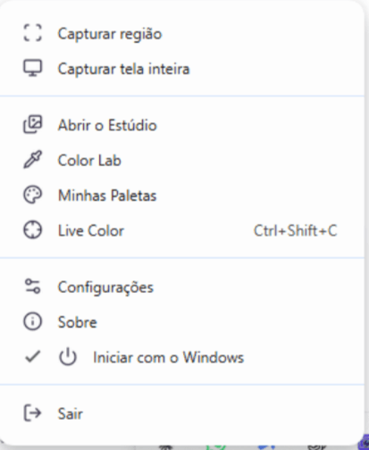</p>

O GCPShot fica na bandeja com acesso rápido à captura, ao Estúdio, ao Color Lab, às paletas, ao Live Color, às configurações e à verificação de atualizações. Também é possível iniciar junto com o sistema.

---

## Linux: Wayland, KDE Plasma e BigLinux

- **Sem a janela "Compartilhar tela":** no Wayland, a captura usa o monitor onde está o mouse. No KDE Plasma/BigLinux ela é silenciosa pelo KWin, a mesma via usada pelo Spectacle, e o app registra a permissão sozinho. No GNOME e em outros ambientes é usado o portal de captura sem seletor de tela. No Sway/Hyprland, o `grim`.
- **Live Color com lupa em tempo real** também no Wayland.
- Pacotes nativos `.deb`, `.rpm` e Arch (`.pkg.tar.zst`), testados automaticamente no Ubuntu, Fedora e Arch a cada versão.

---

## Privacidade

- Capturas, paletas e preferências ficam **somente no seu computador**.
- Desfoque e pixelização escondem informações antes de compartilhar.
- O GCPShot não envia capturas para a internet. A única conexão automática é a verificação de atualizações no GitHub, que pode ser desligada.
- Câmera e microfone não são usados para capturas de imagem.

---

## Desenvolvimento

```bash
npm ci
npm run dev        # modo desenvolvimento
npm test           # testes unitários
npm run typecheck  # verificação de tipos (processo principal e interface)
npm run build      # build de produção
```

Os instaladores são gerados e testados pelo GitHub Actions em Windows, macOS (Apple Silicon e Intel), Ubuntu, Fedora e Arch. Uma tag `v*` publica a release com todos os pacotes e o manifesto de atualização.

As imagens deste documento são ilustrativas e usam conteúdo fictício de demonstração.

---

<p align="center">© Bruno Albertini · Gestão Cultural Pro. Todos os direitos reservados.</p>
